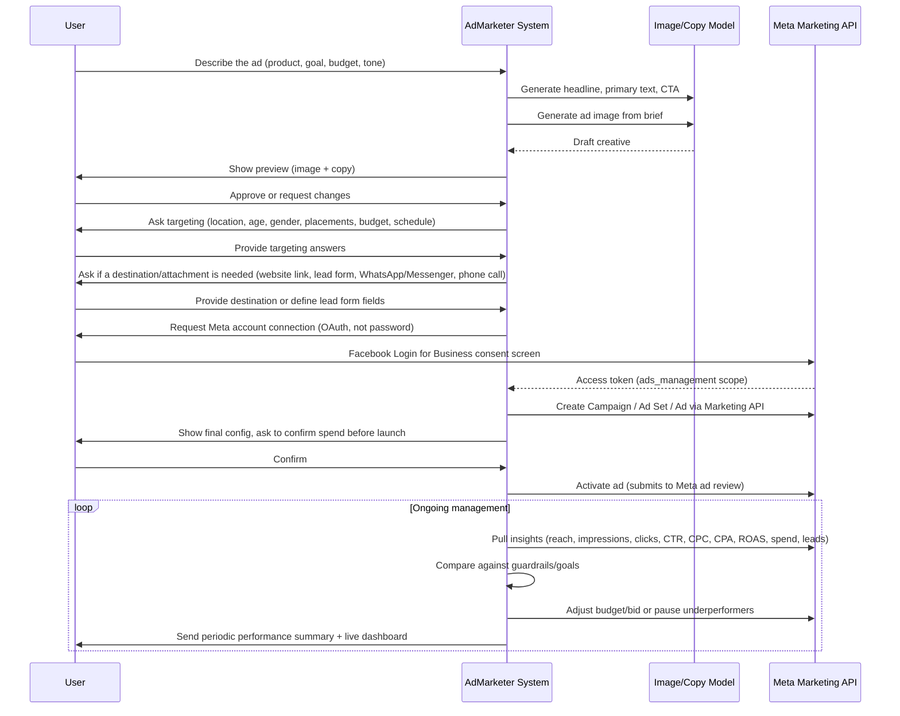
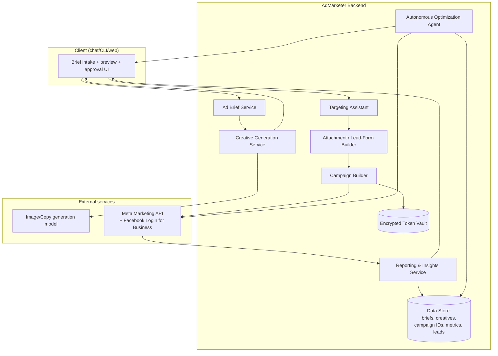

# AdMarketer — Autonomous Facebook Ad Creation & Management System

## 1. Goal

Given a plain-language ad brief, the system should:

1. Generate ad creative (image + copy) using an LLM/image model.
2. Ask the user for targeting details, the same way Facebook's own ad flow does.
3. Let the user optionally attach a destination or lead form (website link, product page, lead-gen form fields) to the ad — same as Meta's own ad creation flow offers.
4. Take the user's Facebook connection and publish a real Campaign → Ad Set → Ad on Meta.
5. Continue to monitor and optimize the campaign afterward, acting like a marketing manager rather than a one-shot publishing tool.
6. Surface full delivery and engagement data back to the user — reach, impressions, clicks, CTR, cost, leads/conversions — not just a launch confirmation.

## 2. User flow

## 3. Component architecture

## 4. Components in detail

### 4.1 Ad Brief Service
Takes the free-text description plus a few structured fields (objective, budget, timeline, brand tone). Normalizes it into a brief object used by every downstream stage.

### 4.2 Creative Generation Service
- **Copy**: LLM generates headline, primary text, description, and CTA options from the brief.
- **Image**: an image-capable model generates the ad visual from the brief (product shot, lifestyle scene, etc). Supports regeneration with feedback ("more minimal", "different color").
- Output is shown to the user for approval before anything is built on Meta's side.

### 4.3 Targeting Assistant
Asks the same questions Meta's own ad flow asks: location, age range, gender, budget (daily/lifetime), schedule, and placements (Facebook/Instagram/Audience Network/Manual vs Advantage+ automatic placements). Note: Meta deprecated granular interest-based "detailed targeting" in Jan 2026 — targeting now leans on broad audience + Advantage+ automation, so this assistant should collect only the inputs Meta still exposes (location/age/gender/budget/objective) rather than interest lists. See [[fb_ads_structure]].

### 4.4 Attachment / Lead-Form Builder
Before the campaign is built, the system asks whether the ad should attach a destination or a data-collection element — mirroring what Meta's own ad creation flow offers at the ad level:
- **Website link**: a URL the ad's CTA button sends people to (with UTM parameters auto-appended for tracking).
- **Instant/Lead form**: an in-Facebook form defined here (which fields to collect — name, email, phone, custom questions) and created via the Marketing API's Lead Ads endpoints. Submitted leads sync back into the Data Store and can be exported or forwarded (e.g. webhook to a CRM).
- **Messaging destinations**: WhatsApp, Messenger, or Instagram DM as the ad's click-through target, for conversation-based objectives.
- **Phone call**: click-to-call destination for local/service businesses.
- **Additional media/info**: extra images for carousel/collection formats, or a product catalog link if promoting multiple items.

Whatever is chosen here becomes part of the Ad-level payload the Campaign Builder sends to Meta.

### 4.5 Meta Connection (never raw credentials)
The user does **not** hand over a Facebook username/password. Instead: **Facebook Login for Business** OAuth flow issues an access token scoped to `ads_management` (+ `pages_show_list`, `business_management` as needed). The token is stored encrypted in a token vault, refreshed as needed, and scoped to the specific ad account/Page the user selects. This is both a Meta platform requirement (raw password login isn't supported for API access) and avoids ever holding the user's actual FB password.

### 4.6 Campaign Builder
Maps the approved brief + targeting + attachment into Meta's hierarchy and creates it through the Marketing API:
- Campaign (objective, budget optimization on/off)
- Ad Set (targeting, placements, schedule, budget, bid strategy, optimization event)
- Ad (uploads the generated image, attaches copy, links Page identity, attaches the chosen destination/lead form)

Campaigns are created **paused** by default; the system asks for explicit confirmation of the spend amount before activating — this is a financial action and should never fire without the user's direct go-ahead.

### 4.7 Reporting & Insights Service
Once an ad is live, this service polls Meta's Insights API on a schedule (e.g. every few hours) and normalizes the numbers into a plain dashboard/report for the user. At minimum it tracks:

- **Reach** — unique people who saw the ad.
- **Impressions** — total times the ad was shown (can exceed reach via repeat views).
- **Frequency** — impressions ÷ reach (how often the same person is seeing it — high frequency signals audience fatigue).
- **Clicks** and **link clicks** — total clicks vs. clicks that actually went to the destination.
- **CTR** (click-through rate) — clicks ÷ impressions.
- **CPC** / **CPM** — cost per click / cost per 1,000 impressions.
- **Spend** — running and total cost against the budget.
- **Conversions/leads** — purchases, sign-ups, or lead-form submissions, pulled via the Pixel/Conversions API or Lead Ads endpoint (see [[fb_ads_measurement]]).
- **CPA / ROAS** — cost per acquisition and return on ad spend, computed from the above.
- **Breakdown views** — by age/gender/placement/device, so the user can see *who* is engaging, not just how many.

This data feeds two consumers: a human-readable report/dashboard for the user, and the Optimization Agent's decision logic.

### 4.8 Autonomous Optimization Agent ("marketing head" behavior)
A recurring job (e.g. hourly/daily) that:
- Reads the latest numbers from the Reporting & Insights Service.
- Compares against the guardrails the user set upfront (max daily spend, target CPA/ROAS, minimum runtime before judging an ad).
- Takes bounded actions: pause a clearly underperforming ad, reallocate budget between ad sets, duplicate a winning ad — all within pre-approved limits.
- Anything outside those limits (raising the total budget cap, launching a brand-new campaign) goes back to the user for confirmation rather than being done silently.
- Sends the user a periodic plain-language summary ("Ad set A is outperforming B 2:1 on CPA, shifted $20/day toward it").

### 4.9 Data Store
Persists briefs, generated creative assets, campaign/ad set/ad IDs, attachment/lead-form configs, collected leads, and a time series of performance metrics (reach, impressions, clicks, spend, conversions) — needed both for the optimization agent's decisions and for reporting back to the user.

## 5. Guardrails (by design, not an afterthought)

- No raw Facebook credentials are ever collected or stored — OAuth only.
- No spend happens without an explicit user confirmation of the budget for that specific campaign.
- The optimization agent operates inside limits the user sets (max daily spend, target CPA) — it does not raise its own ceiling.
- All autonomous actions (pause/reallocate/duplicate) are logged and summarized back to the user, not silent.
- Lead-form data (names, emails, phone numbers) is treated as personal data: encrypted at rest, only exported/forwarded with the user's say-so, never used for anything beyond the ad the person responded to.

## 6. Suggested tech stack

- **Backend**: Python or Node.js service exposing the brief/creative/targeting/build steps.
- **Image/copy generation**: any multimodal-capable LLM API (Claude, or an image-specific model) — pluggable so the generation backend can be swapped.
- **Facebook integration**: Meta Business SDK (Python/Node) over the Marketing API + Facebook Login for Business for OAuth.
- **Data store**: Postgres for briefs, campaigns, leads, and metrics history.
- **Scheduler**: a worker/cron process for both the Insights polling loop and the optimization agent.
- **Dashboard**: a simple web view (or chat-delivered report) showing reach/impressions/clicks/CTR/spend/leads per campaign, refreshed on each poll.
- **Token vault**: encrypted at rest (e.g. KMS-backed secret store), scoped per ad account.

## 7. Phased build plan

1. **Phase 1 — Assisted creation**: brief → creative generation → targeting Q&A → attachment/lead-form choice → OAuth connect → build campaign paused → user manually reviews and hits launch in Ads Manager.
2. **Phase 2 — Assisted publish + reporting**: system launches the confirmed campaign directly via the API; Reporting & Insights Service comes online with a dashboard showing reach/impressions/clicks/CTR/spend/leads.
3. **Phase 3 — Autonomous optimization**: the agent starts taking bounded actions (pause/reallocate) within user-set guardrails, using the reporting data, with logged summaries.
